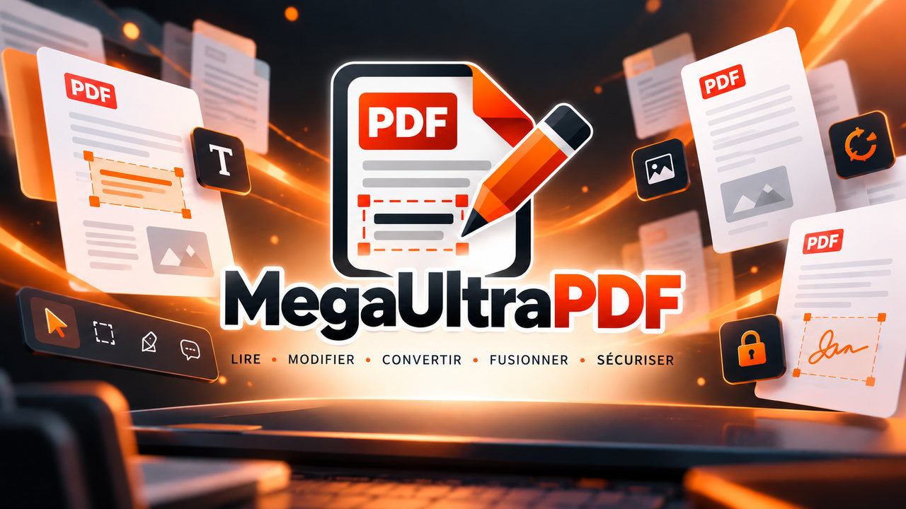

# MegaUltraPDF



Lecteur et éditeur PDF libre, sans publicité ni télémétrie, écrit en Rust.
Le projet est aussi un support d'apprentissage de Rust : le code est commenté en français
et chaque lot de fonctionnalités s'accompagne d'une note d'apprentissage (`docs/apprentissage/`).

- Moteur PDF : PDFium (celui de Chrome) via `pdfium-render`, piloté exclusivement par `mega-core`.
- Interface : Tauri 2 (backend Rust) + Svelte 5 / TypeScript, sur le WebView2 du système.
- Licence : GPL-3.0-or-later.
- Visuels (icône, logo, icônes d'actions, bannière) : créés pour le projet par son propriétaire
  (`assets/brand/`, images dérivées par `cargo xtask brand`).

## État (voir `docs/ROADMAP.md`)

| Lot | Contenu | État |
|---|---|---|
| 0 | Fondations : cœur Rust, CLI `info`/`render`, application qui affiche la page 1, outillage | ✅ |
| 1 | Lecteur complet (onglets, zoom, rotation, vignettes, signets, liens, sélection, recherche, propriétés, thème, raccourcis) | ✅ |
| 2 | Pages et documents (pivoter, supprimer, réordonner, extraire, insérer, fusionner, scinder, enregistrer, annuler/rétablir) | ✅ |
| 3 | Annotations (marquages de texte, notes, texte, encre, formes, tampons ; panneau ; rendu des annotations existantes) | ✅ |
| 4 | Formulaires (champs HTML natifs, remplissage, aplatir, XFA détecté) et signature visuelle | ✅ |
| 5 | Édition de contenu (objets de page, texte et images, caviardage réel, filigrane, numérotation, recadrage, pages tournées) | ✅ |
| 6 | Export (images, texte), impression, métadonnées, protection AES-256, optimisation, pièces jointes, comparaison | ✅ |
| 7 | Finition et distribution (interface FR/EN, accessibilité, préférences, aide, licences, installeurs) | ✅ |
| 8 | Options avancées : OCR (Tesseract), signature numérique cryptographique et vérification | ✅ |
| 9 | Consolidation : environ 80 améliorations et corrections reportées des lots précédents | ✅ |
| 10 | Police Unicode incorporée, caviardage partiel d'images, signature visible, documents chiffrés | ✅ |
| 11 | Lecteur PDF par défaut : une seule instance (fichiers en onglets), état et bouton dans les préférences | ✅ |
| 12 | Identité visuelle : icône d'application, icônes d'actions, logo, bannière | ✅ |

## Installation

Les paquets sont produits par la CI (`.github/workflows/release.yml`) et joints aux releases
GitHub : installeur NSIS ou MSI et version portable (zip) pour Windows, deb et AppImage pour
Linux, dmg pour macOS (Apple Silicon). PDFium est inclus. L'installeur Windows est vérifié
de bout en bout ; les paquets Linux et macOS sont construits par la CI mais pas encore
essayés sur une machine réelle.

Les paquets ne sont **pas signés** : Windows affiche un avertissement SmartScreen
(« Informations complémentaires » puis « Exécuter quand même ») ; macOS demande d'ouvrir
l'application par clic droit > Ouvrir la première fois.

Construire un paquet soi-même (après le démarrage rapide ci-dessous) :

```bash
pnpm --dir app release                 # tous les paquets de la plateforme courante
pnpm --dir app release --bundles nsis  # seulement l'installeur NSIS
```

`release` prépare PDFium (`cargo xtask stage-pdfium`) et l'embarque ; un `pnpm tauri build`
direct produirait un paquet sans PDFium. Les licences tierces sont regénérées par
`cargo xtask licenses` (`THIRD_PARTY_LICENSES.md`).

## OCR et signature numérique

- **OCR** : installez [Tesseract](https://github.com/tesseract-ocr/tesseract) avec les
  langues voulues (par exemple `fra` et `eng`). L'application le trouve dans le `PATH`, dans
  son dossier d'installation usuel, ou via la variable `MEGA_TESSERACT`. Menu Contenu ▸
  « Reconnaître le texte (OCR)… », ou en ligne de commande :
  `mega ocr numerise.pdf --lang fra+eng -o cherchable.pdf`.
- **Signature** : un certificat personnel au format PKCS#12 (`.p12` / `.pfx`). Menu Fichier
  ▸ « Signer numériquement… », ou `mega sign doc.pdf --p12 moi.p12 -o signe.pdf` (mot de
  passe lu dans `MEGA_P12_PASSWORD` ou sur l'entrée standard). `mega signatures doc.pdf`
  vérifie les signatures d'un fichier. « Intègre » signifie que le contenu signé n'a pas
  changé ; l'identité du signataire n'est pas certifiée (aucune autorité n'est consultée).

## Prérequis (développement)

- **Rust stable** via [rustup](https://rustup.rs) (`rustc`, `cargo`, `rustfmt`, `clippy`).
- **Visual Studio 2022** avec la charge « Développement Desktop C++ » (ou les Build Tools 2022
  avec le même composant) : fournit l'éditeur de liens MSVC utilisé par Rust sous Windows.
- **Node.js ≥ 22** et **pnpm ≥ 9** pour l'interface (Tauri 2 + Svelte).
- **WebView2** (inclus dans Windows 11).
- **GitHub CLI** (`gh`), optionnel, pour les pull requests et la CI.
- Sous Linux : les dépendances Tauri 2 (`libwebkit2gtk-4.1-dev`, `libayatana-appindicator3-dev`,
  `librsvg2-dev`, `patchelf`, `build-essential`, `libssl-dev`).

Installation rapide sous Windows (winget) :

```powershell
winget install --id Rustlang.Rustup --exact
winget install --id GitHub.cli --exact
```

## Démarrage rapide

```bash
cargo xtask fetch-pdfium            # bibliothèque PDFium épinglée, somme de contrôle vérifiée
pnpm --dir app install              # dépendances du frontend
cargo test --workspace              # tests Rust
pnpm --dir app tauri dev -- -- fixtures/simple.pdf   # lance l'application sur un fichier
```

## Ligne de commande

```bash
cargo run -p mega-cli -- info fixtures/simple.pdf
cargo run -p mega-cli -- render fixtures/simple.pdf --page 1 --scale 2 --out page1.png
cargo run -p mega-cli -- info fixtures/encrypted.pdf --password secret
cargo run -p mega-cli -- merge a.pdf b.pdf -o fusion.pdf
cargo run -p mega-cli -- split rapport.pdf --every 10 -o parties/      # ou --ranges "1-3,4-" / --bookmarks
cargo run -p mega-cli -- rotate rapport.pdf --pages 1,3-4 --degrees 90 -o tourne.pdf
cargo run -p mega-cli -- extract rapport.pdf --pages 2-3 -o extrait.pdf
cargo run -p mega-cli -- annots rapport.pdf --page 1                      # liste les annotations
cargo run -p mega-cli -- fields formulaire.pdf                             # liste les champs
cargo run -p mega-cli -- flatten formulaire.pdf -o plat.pdf                # aplatit
cargo run -p mega-cli -- objects rapport.pdf --page 1                     # objets du contenu
cargo run -p mega-cli -- redact rapport.pdf --pages 1-2 --rect 60,740,200,40 -o caviarde.pdf
cargo run -p mega-cli -- watermark rapport.pdf --text BROUILLON -o marque.pdf
cargo run -p mega-cli -- number rapport.pdf --template "{n} / {total}" --corner bottom_center -o numerote.pdf
cargo run -p mega-cli -- crop rapport.pdf --margins 50,50,50,50 --pages 1 -o rogne.pdf
cargo run -p mega-cli -- export-images rapport.pdf -o images/ --dpi 150        # ou --jpeg --quality 80
cargo run -p mega-cli -- export-text rapport.pdf -o rapport.txt
cargo run -p mega-cli -- meta rapport.pdf --title "Titre" --author "Moi" -o meta.pdf
cargo run -p mega-cli -- protect rapport.pdf --user secret --owner patron --no-print -o verrou.pdf
cargo run -p mega-cli -- unprotect verrou.pdf --password patron -o ouvert.pdf
cargo run -p mega-cli -- optimize rapport.pdf --quality 75 --max-px 2048 -o leger.pdf
cargo run -p mega-cli -- attachments rapport.pdf --extract 0 -o piece.bin
cargo run -p mega-cli -- compare v1.pdf v2-chiffre.pdf --page 3 --password-b secret -o diff.png
```

Toutes les écritures sont atomiques (fichier temporaire puis renommage) : un échec ne laisse
jamais un fichier à moitié écrit. Un fichier de sortie qui existe déjà (y compris le fichier
source) n'est **jamais écrasé** sans l'option globale `--force` (`mega --force rotate …` ou
`mega rotate … --force`). Réécrire un PDF signé affiche un avertissement : la signature ne
sera plus valide dans le fichier produit (`mega sign`, lui, ajoute sa signature sans rien
invalider).

## Vérifier l'interface sans souris

```powershell
scripts/ui-check.ps1 -Pdf fixtures/simple.pdf -Scenario scripts/scenarios/lecteur-simple.json
scripts/ui-check.ps1 -Pdf copie.pdf -Scenario scripts/scenarios/edition-pages.json   # modifie le fichier !
scripts/ui-check.ps1 -Pdf copie.pdf -Scenario scripts/scenarios/annotation.json      # idem
scripts/ui-check.ps1 -Pdf copie-form.pdf -Scenario scripts/scenarios/formulaire.json  # idem
scripts/ui-check.ps1 -Pdf copie.pdf -Scenario scripts/scenarios/contenu.json         # idem (Lot 5)
scripts/ui-check.ps1 -Pdf copie-rotated.pdf -Scenario scripts/scenarios/rotation.json # page /Rotate 90
scripts/ui-check.ps1 -Pdf copie.pdf -Scenario scripts/scenarios/export-securite.json  # Lot 6 (modifie et chiffre la copie)
scripts/ui-check.ps1 -Pdf copie-pj.pdf -Scenario scripts/scenarios/pieces-jointes.json
scripts/ui-check.ps1 -Pdf copie.pdf -Scenario scripts/scenarios/finition.json       # Lot 7 : clavier, langue, aide
scripts/ui-check.ps1 -Exe <dossier installé>\mega-app.exe -Pdf fixtures/simple.pdf -Scenario scripts/scenarios/lecteur-simple.json
```

Lance l'application avec le port de débogage WebView2, déroule un scénario (clics, touches,
glisser, captures d'écran) et affiche ✔/✘ par assertion. Captures dans `target/ui-check/`.

## Organisation du dépôt

```
crates/mega-core/   logique PDF (seul crate qui parle à PDFium)
crates/mega-cli/    binaire `mega`
app/src-tauri/      backend Tauri (commandes, protocole mega://, registre)
app/src/            frontend SvelteKit (présentation seulement)
xtask/              tâches de dev (fetch-pdfium, gen-fixtures)
fixtures/           PDF de test
docs/               feuille de route, liste des fonctionnalités, ADR, notes d'apprentissage, specs et plans
scripts/            vérification de l'interface par scénarios (CDP)
.claude/            environnement Claude Code (règles, hooks, compétences, agents)
```

Contribuer : voir `CONTRIBUTING.md`. Règles de travail : `CLAUDE.md`.
